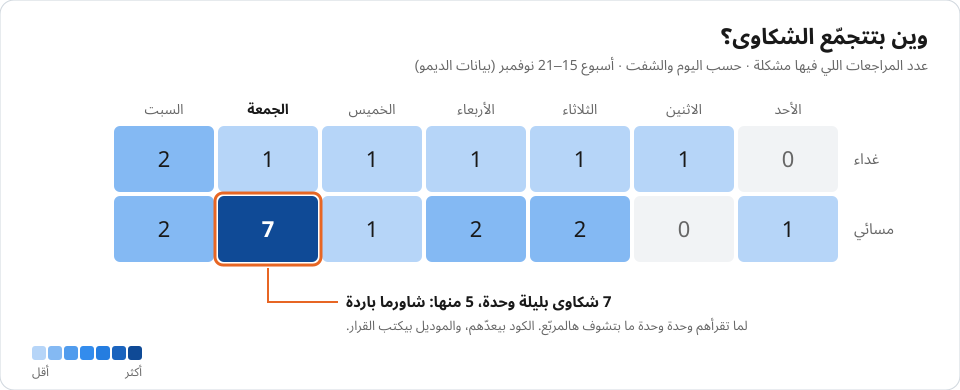
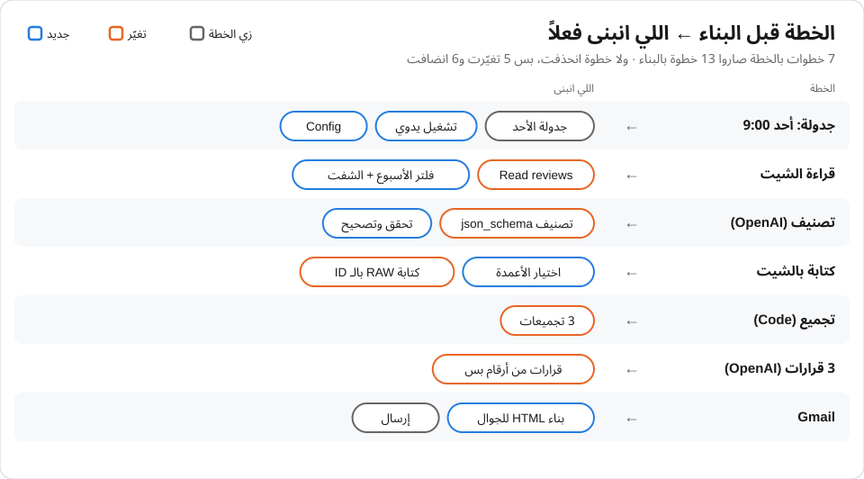

<p align="center">
  <picture>
    <source media="(prefers-color-scheme: dark)" srcset="assets/hero-dark.svg">
    
  </picture>
</p>

<p align="center">
  
  
  
  
  
  
</p>

<h3 align="center">صاحب المطعم بيقرأ 5 مراجعات سيئة… وما بيعرف إنهم عن <b>نفس الصحن، بنفس الشفت</b>.</h3>

<p align="center">
  <i>A weekly n8n + OpenAI workflow that turns scattered restaurant reviews into 3 concrete kitchen decisions.</i><br>
  <a href="#demo">النتيجة</a> · <a href="#how">كيف بيشتغل</a> · <a href="#proof">الإثبات</a> · <a href="#run">شغّله</a> · <a href="#docs-experiment">تجربة التوثيق</a>
</p>

---

## بنظرة

| 📥 بيدخل | ⚙️ بيصير | 📤 بيطلع |
|:---|:---|:---|
| **40 مراجعة** بالأسبوع من Google وطلبات وكريم وإنستغرام، بالفصحى واللهجة والإنجليزي | كل مراجعة بتتصنّف (الصحن، المشكلة، الحدّة)، **والكود بيعدّ الأنماط** | إيميل الأحد 9:00 للمدير والشيف: **3 قرارات تشغيلية** + جدول الأنماط + **مسودة رد** لكل مراجعة سلبية |

| | بدون النظام | مع النظام |
|---|---|---|
| مين بيقرأ؟ | المدير، مراجعة مراجعة | النظام، كل أحد الصبح |
| شو بيشوف؟ | 16 زبون زعلان | **نمط واحد واضح:** شاورما · الجمعة مسائي · 5 شكاوى برودة |
| شو بيصير بعدها؟ | رد "نعتذر عن الإزعاج" | **أمر شغل للمطبخ:** مين، شو، وإيمتى |
| الردود على الزباين | من الصفر لكل وحدة | مسودة جاهزة بلغة الزبون، بتنراجع وبتنشر |

---

<a id="demo"></a>
## 🎯 النتيجة

### النمط اللي ما بتشوفه العين

<picture>
  <source media="(prefers-color-scheme: dark)" srcset="assets/heatmap-dark.svg">
  
</picture>

40 مراجعة موزّعة على 7 أيام. وحدة وحدة، كل شكوى بتبيّن حادثة منفردة. بس لما تنعدّ حسب **اليوم × الشفت × الصحن**، بيطلع مربّع واحد فيه 7 شكاوى، منها 5 عن نفس الإشي.
<sub>الخريطة مولّدة من <code>data/</code> عبر <code>node dev/make-visuals.mjs</code>.</sub>

### شو بيوصل على الجوال

<table>
<tr>
<td width="44%" valign="top"></td>
<td valign="top">

**1. سطر واحد بالأعلى**
أهم نمط بالأسبوع، وجنبه اقتراح.

**2. أرقام الأسبوع**
عدد المراجعات، وقدّيش منها فيها مشكلة، ومعدّل التقييم.

**3. ثلاث قرارات**
كل قرار إله **مسؤول** (الشيف، مدير الصالة، التوصيل) و**أولوية** و**دليل بالأرقام** و**إجراء بينفحص بالشفت الجاي**.

**4. جدول الأنماط**
صحن × شفت، وتحته مشاكل الويكند مقابل أيام الدوام.

**5. مسودات الردود**
لكل مراجعة سلبية، بلغة الزبون، مرتّبة حسب الحدّة. ما بتوعد بتعويض، وما بتلوم الزبون.

<sub>⚠️ اللقطة من الاختبار المحلي: الأرقام والجداول حقيقية من الكود، أما نصوص القرارات والردود فوهمية لأنو OpenAI مش مربوط بالاختبار.</sub>

</td>
</tr>
</table>

---

<a id="how"></a>
## ⚙️ كيف بيشتغل

```mermaid
flowchart LR
  T1([⏰ أحد 9:00]) --> C[Config]
  T2([▶️ تشغيل يدوي]) --> C
  C --> R[(📄 Google Sheet<br/>المراجعات)]
  R --> P[فلتر الأسبوع<br/>+ حساب الشفت]
  P --> AI1{{🤖 تصنيف كل مراجعة<br/>json_schema strict}}
  AI1 --> V[تحقق وتصحيح]
  V --> W[(📄 كتابة التصنيف<br/>جنب كل مراجعة)]
  W --> G[🧮 عدّ الأنماط<br/>3 تجميعات]
  G --> AI2{{🤖 3 قرارات<br/>من الأرقام بس}}
  AI2 --> E[بناء HTML<br/>RTL · 600px]
  E --> M([📧 Gmail])

  classDef ai fill:#fff1e8,stroke:#e76624,stroke-width:2px,color:#191919
  classDef code fill:#e8f1fd,stroke:#257de0,stroke-width:2px,color:#191919
  classDef io fill:#f2f4f7,stroke:#8b949e,color:#191919
  class AI1,AI2 ai
  class P,V,G,E,C code
  class T1,T2,R,W,M io
```

<!-- WORKFLOW_SCREENSHOT -->



<p align="center"><sub>🟧 ذكاء اصطناعي (فهم لغة) · 🟦 كود (حساب وقواعد) · ⬜ مدخلات ومخرجات</sub></p>

| # | الخطوة | مين بيعملها | ليش هيك |
|---|---|---|---|
| 1 | قراءة مراجعات آخر 7 أيام | Google Sheets | العميل أصلاً بيجمّعها بشيت |
| 2 | الشفت من وقت الزيارة | **كود** | يوم الأسبوع ما بيتخمّن |
| 3 | الصحن، نوع المشكلة، الحدّة، ملخّص، مسودة رد | **OpenAI** (mini) | فهم لهجة: "الساندويش بارد" = شاورما |
| 4 | التحقق من كل رد | **كود** | رد خربان بيتعلّم ⚠️، وما بيوقّف التقرير |
| 5 | العدّ والترتيب | **كود** | الأرقام لازم تكون صح 100% |
| 6 | 3 قرارات | **OpenAI**، من الأرقام بس | صياغة، مش حساب |
| 7 | إيميل HTML | **كود** + Gmail | مقروء على الجوال، عربي من اليمين |

---

## 🧠 خمس قرارات هندسية

<details>
<summary><b>1. الموديل بيصنّف، والكود بيعدّ</b>: مستحيل يقول "7 شكاوى" إذا الحقيقة 5</summary>

<br>

موديل القرارات ما بيشوف ولا مراجعة. بيوصله ملخّص أرقام جاهز:

```js
// dev/code-nodes/05-aggregate-patterns.js
const byDishShiftIssue = groupBy(issues, ['dish', 'shift', 'issue_type']);
const byIssueWeekPart  = groupBy(issues, ['issue_type', 'week_part']);   // تأخير التوصيل = نمط ويكند
const byDishIssue      = groupBy(issues, ['dish', 'issue_type']);
// ...sorted by count, then by total severity
```

والـ prompt بيفرض: *"cite ONLY numbers present in the input… a likely cause must be phrased as a hypothesis"*.
</details>

<details>
<summary><b>2. قوائم مغلقة بدل نص حر</b>: "شاورما" و"ساندويش شاورما دجاج" نفس الصحن</summary>

<br>

```js
// dev/code-nodes/02-prepare-week.js — OpenAI Structured Outputs, strict
dish:       { type: 'string',  enum: [...cfg.menu, 'عام', 'غير محدد'] },
issue_type: { type: 'string',  enum: ['cold_food', 'taste_quality', 'delivery_delay', 'hygiene', /* … */ 'none'] },
severity:   { type: 'integer', enum: [0, 1, 2, 3, 4, 5] },
```

لو الصحن نص حر، الشكاوى الخمسة كانت رح تتوزّع على 3 أسماء، وما كان في نمط ينعدّ.
</details>

<details>
<summary><b>3. الشفت من البيانات، مش من التخمين</b></summary>

<br>

```js
const part = visit.getUTCHours() < cfg.evening_starts_at_hour ? 'غداء' : 'مسائي';
row.shift = `${DAYS_AR[dow]} · ${part}`;           // "الجمعة · مسائي"
```

البيانات فيها **فخ مقصود**: شكوى شاورما باردة يوم الثلاثاء غدا (R007). النظام ما بيضمّها لنمط الجمعة، لأنو الشفت مختلف.
</details>

<details>
<summary><b>4. مقياس حدّة مكتوب</b>: شعرة بالأكل أهم من 3 شكاوى ملح</summary>

<br>

| 0 | 1 | 2 | 3 | 4 | 5 |
|---|---|---|---|---|---|
| ما في مشكلة | ملاحظة بمراجعة إيجابية | مشكلة واضحة | خرّبت جزء من الوجبة | خرّبت الزيارة | صحة وسلامة |

الشكاوى بحدّة 4 فما فوق بتوصل لموديل القرارات حتى لو كانت **منفردة**.
</details>

<details>
<summary><b>5. آمن بالتصميم</b></summary>

<br>

- **ولا مفتاح API** بأي node: كله عبر n8n credentials
- الكتابة بالشيت بوضع **RAW**: مراجعة بتبلّش بـ `=` ما بتصير معادلة
- كل نص من الزباين بيتعقّم (escape) قبل ما يدخل الـ HTML
- workflow تنبيه أخطاء مشترك (`shared/error-alert.workflow.json`)
</details>

---

<a id="proof"></a>
## ✅ الإثبات: 10 فحوصات بدون ولا مفتاح

البيانات التجريبية فيها أنماط مزروعة **معروف عددها**، والإجابات الصحيحة بـ [`data/expected-labels.csv`](data/expected-labels.csv). الاختبار بيشغّل كود الـ workflow نفسه (مقروء من `workflow.json`) مع OpenAI وهمي:

```bash
node dev/run-local.mjs
```

```text
✅ date filter: 40 reviews this week, R041/R042 (last week) excluded
✅ shift computed from visit time (R021 → الجمعة · مسائي, R007 → الثلاثاء · غداء)
✅ top pattern = شاورما · الجمعة مسائي · cold_food × 5 (got شاورما · الجمعة · مسائي · cold_food × 5)
✅ decoy cold shawarma on Tuesday lunch is NOT merged into the Friday pattern
✅ delivery delays on the weekend grouped (×3)
✅ positive reviews never counted as issues (incl. positive shawarma R008/R036/R040)
✅ bad model answer (R010) → flagged needs_review, run continues
✅ decisions model receives only aggregates (no review text)
✅ email: RTL, ≤600px, all user text escaped
✅ sheet write-back has exactly the label columns

stats: {"total":40,"issues":22,"negative":16,"positive":18,"avg_rating":3.6,"needs_review":1,"tokens":16380}
subject: 📋 مراجعات الأسبوع · بيت الصاج · 2026-11-15 ← 2026-11-21
```

| المزروع بالبيانات | ليش موجود |
|---|---|
| 5 شكاوى شاورما باردة · الجمعة مسائي | النمط اللي لازم يطلع أول |
| 3 تأخير توصيل موزّعين على الجمعة والسبت | نمط **ويكند**، مش شفت |
| شاورما باردة · الثلاثاء غدا | فخ: ما لازم تنضم للجمعة |
| 3 مراجعات **بتمدح** الشاورما | فخ: ذكر الصحن ≠ شكوى |
| مراجعتين من الأسبوع الماضي | فخ: فلتر التاريخ |
| شعرة بالفتوش | شكوى وحدة بحدّة 5 |

> الاختبار المحلي بيفحص **التمديدات** (الفلترة، العدّ، الإيميل). دقة الموديل الحقيقية بتنقاس بأول تشغيل مقابل `expected-labels.csv`.

---

<a id="run"></a>
## 🚀 شغّله

| المفتاح | لأي node |
|---|---|
| **OpenAI API** | تصنيف + قرارات |
| **Google Sheets OAuth2** | قراءة + كتابة |
| **Gmail OAuth2** | الإيميل + تنبيه الأخطاء |

1. **Import from File** ← [`shared/error-alert.workflow.json`](shared/error-alert.workflow.json)، وبعدين [`workflow.json`](workflow.json)
2. node **Config** ← `sheet_id` و `report_to`
3. اربط الـ credentials الثلاثة
4. Settings ← Error workflow ← `D0 · error-alert`
5. **Execute workflow** ← الإيميل بيوصل خلال دقيقة تقريباً

📖 التفاصيل الكاملة (Google OAuth، الشيت، الإنتاج، التكلفة) بـ [`docs/SETUP.md`](docs/SETUP.md) · وشو لازم ينفحص بعد أول تشغيل بـ [`docs/review-checklist.md`](docs/review-checklist.md)

**التكلفة (تقديري):** أقل من 3 سنت لـ 40 مراجعة بـ `gpt-4.1-mini`.

---

## 🚧 حدود النسخة الحالية

- **بيحتاج وقت الزيارة** عشان يحسب الشفت. مراجعات Google لحالها ما فيها هالمعلومة، بس تطبيقات التوصيل وأنظمة الكاشير فيها.
- **ما بينشر الردود لحاله.** المسودة بتضل بإيد المدير، وهاد مقصود.
- **إذا ما في مراجعات بالأسبوع**، ما بيوصل إيميل (التشغيل بيوقف بهدوء).
- **المنيو لازم ينكتب مرة وحدة** بـ Config. صحن جديد مش بالقائمة بيطلع "غير محدد".

---

<a id="docs-experiment"></a>
## 📝 تجربة التوثيق: README أول

هاد المشروع هو **اليوم 1 من تحدي "7 أيام · 7 مشاريع"**، وكل يوم بنجرّب طريقة توثيق مختلفة. طريقة اليوم: **التوثيق بينكتب قبل البناء**، وبعد البناء بنقارن.

النسخة الأصلية انحفظت لحالها بـ [أول commit](https://github.com/Sfditala/review-to-kitchen-report/commit/11d33a2) قبل أي سطر كود، وموجودة حرفياً تحت.

<picture>
  <source media="(prefers-color-scheme: dark)" srcset="assets/plan-vs-reality-dark.svg">
  
</picture>

### النتيجة بسطرين
**الهيكل صمد، والتفاصيل لأ.** ولا خطوة من الخطة انحذفت، بس 5 nodes تغيّروا عن الخطة و6 انضافوا.
وأهم سؤال فات الكتابة المسبقة: **"الشفت من وين بيجي؟"** والجواب غيّر شكل البيانات نفسها.

<details>
<summary><b>كل التغييرات الـ 11 عن الخطة، وليش</b></summary>

<br>

| # | بالخطة | اللي انبنى فعلاً | ليش |
|---|---|---|---|
| 1 | الموديل بيستخرج `shift` من النص | **الشفت بينحسب بالكود** من عمود جديد `visit_datetime` (اليوم + قبل/بعد الساعة 4) | المراجعة نادراً بتحكي "الجمعة المسا". لو الموديل خمّن، النمط المزروع ما رح ينكشف. والكود ما بيغلط بيوم الأسبوع |
| 2 | `dish` نص حر | **قائمة مغلقة** (المنيو بـ Config) + `عام` + `غير محدد` | "شاورما"، "ساندويش شاورما دجاج"، "شاورما العربي" كانوا رح يتوزّعوا على 3 مجموعات، والعدّ يتكسّر |
| 3 | node الـ OpenAI | **HTTP Request** لـ Chat Completions مع `json_schema strict` (بنفس credential الـ OpenAI) | Structured Output حقيقي: الموديل ما بيقدر يطلّع قيمة برّا القائمة. وما بيتأثر بتغيّر إصدارات node الـ OpenAI |
| 4 | تجميع وحيد `dish × shift × issue` | **3 تجميعات:** صحن×شفت×مشكلة · مشكلة×(ويكند/دوام) · صحن×مشكلة | تأخير التوصيل نمط **ويكند** مش شفت معيّن (جمعة مسا، سبت غدا، سبت مسا). بالتجميع الوحيد كان رح يطلع 3 شكاوى منفردة |
| 5 | (مش مذكور) | **مقياس حدّة 0–5 مكتوب** + الشكاوى الحرجة المنفردة (حدّة ≥ 4) بتوصل لموديل القرارات | شعرة بالأكل شكوى وحدة بس أخطر من 3 شكاوى ملح. العدّ لحاله بيدفنها |
| 6 | (مش مذكور) | موديل القرارات بياخد **أرقام جاهزة بس**، ولا نص مراجعة | العدّ بالكود. الموديل بيكتب القرار وما بيعدّ. ومستحيل يخترع "7 شكاوى" إذا الكود قال 5 |
| 7 | "قراءة مراجعات الأسبوع" | node **Prepare week**: فلتر 7 أيام + `reference_date` للديمو + قراءة التاريخ كرقم أو نص | Google Sheets أحياناً بيحوّل التاريخ لرقم تسلسلي. وبدون `reference_date` الديمو ما بيشتغل إلا بأسبوع 15–21 نوفمبر |
| 8 | (مش مذكور) | **Parse classification**: إذا رد الموديل خربان ← المراجعة بتتعلّم ⚠️ والتشغيل بيكمّل | مراجعة وحدة خربانة ما لازم توقّف تقرير 40 مراجعة |
| 9 | (مش مذكور) | الكتابة بالشيت بوضع **RAW** | مراجعة بتبلّش بـ `=` ما بتتنفّذ كمعادلة |
| 10 | (مش مذكور) | **Config** node + **Manual Trigger** + workflow تنبيه أخطاء مشترك | كل الإعدادات بمكان واحد، والتجربة بدون ما نستنّى الأحد |
| 11 | تاب اسمه `reviews` | الشيت بينقرأ **بالـ ID** (`gid=0`) مش بالاسم | Google سمّى التاب تلقائياً وقت تحويل الـ CSV. القراءة بالـ ID ما بتنكسر لو حدا غيّر الاسم |
</details>

### القياس

| السؤال | الجواب |
|---|---|
| كم من الخطة ضل زي ما هو؟ | خطوات التدفق 7/7 · حقول التصنيف 5/6 (الشفت طلع للكود) · معايير النجاح 5/5 **+ 2 جداد** |
| هل الكتابة المسبقة سرّعت البناء؟ | **آه:** كل معيار نجاح صار فحص بـ `run-local.mjs`، فكان "خلصنا" معرّف من أول دقيقة |
| وين قصّرت؟ | وصفت **شو** بدنا، بس ما سألت **من وين بتيجي كل معلومة** |

### اقتراح للقالب: "مصدر كل حقل"
لو هالجدول كان بالـ README المسبق، التغييرين 1 و 2 كانوا انكشفوا قبل البناء:

| الحقل | من وين؟ | ليش؟ |
|---|---|---|
| `review_text`، `rating`، `source` | **المدخل** (الشيت) | بيانات خام |
| `visit_datetime` | **المدخل** (تطبيق التوصيل / الكاشير) | بدونه ما في شفت |
| `shift`، `week_part` | **الكود** | حساب ثابت من الوقت |
| `dish`، `issue_type`، `severity` | **الموديل**، من قوائم مغلقة | فهم لغة، بقيم بتنعدّ |
| `summary`، `reply_draft` | **الموديل**، نص حر | كتابة |
| العدّ، الترتيب، الإحصائيات | **الكود** | الأرقام لازم تكون صح 100% |
| القرارات الثلاثة | **الموديل**، من أرقام الكود بس | صياغة، مش حساب |

<details>
<summary><b>📜 النسخة الأصلية: انكتبت قبل البناء، بدون أي تعديل</b></summary>

<br>

### review-to-kitchen-report

> **طريقة التوثيق اليوم: README أول.**
> كل اللي فوق الخط الفاصل انكتب **قبل** أول سطر بناء، وانحفظ بـ commit لحاله (`git log -- docs/README.md` بيثبت الترتيب).
> القسم اللي تحت الخط بينكتب **بعد** البناء، ومش مسموح نعدّل اللي فوقه. المقارنة بين النصّين هي التجربة.

---

#### المشكلة (جملة)

صاحب المطعم بيقرأ المراجعات السيئة وحدة وحدة، فما بيلاحظ إنو 6 منها عن **نفس الصحن بنفس الشفت**، وبتضل الشكوى "زعل زبون" بدل ما تصير **أمر شغل للمطبخ**.

#### المستخدم (مين ووقتيش)

| مين | شو بيعمل | وقتيش |
|---|---|---|
| **مدير المطعم** | بيقرأ الملخص والقرارات، بيوزّع المهام، بينسخ مسودات الردود وبينشرها | الأحد الصبح، قبل اجتماع الأسبوع |
| **الشيف الرئيسي** | بيقرأ القرارات اللي بتخص المطبخ | نفس الإيميل |
| **الموظف اللي بيدخّل المراجعات** | بيلصق مراجعات (Google، طلبات، تطبيقات توصيل) بالشيت | طول الأسبوع |

#### المدخلات والمخرجات

**المدخلات**
- Google Sheet اسمه `reviews` فيه سطر لكل مراجعة: رقم المراجعة، التاريخ، المصدر، التقييم (1–5)، نص المراجعة.
- مراجعات بالعربي الفصيح واللهجة والإنجليزي، مخلوطة.

**المخرجات**
1. **جنب كل مراجعة بالشيت:** `dish` · `shift` · `issue_type` · `severity` · `summary` · `reply_draft`
2. **إيميل HTML أسبوعي** للمدير والشيف فيه:
   - ملخص بأرقام (كم مراجعة، كم سلبية، معدّل التقييم)
   - **3 قرارات تشغيلية** مبنية على الأنماط
   - جدول الأنماط (صحن × شفت × مشكلة، مرتّب بالتكرار والحدّة)
   - مسودة رد لكل مراجعة سلبية

#### التدفق (قبل البناء)

```
Schedule (أحد 9:00)
 → Google Sheets: قراءة مراجعات الأسبوع
 → OpenAI (Structured Output): {dish, shift, issue_type, severity, summary, reply_draft}
 → Sheets: كتابة التصنيف جنب كل مراجعة
 → Code: تجميع (dish × shift × issue) + ترتيب حسب التكرار والحدّة
 → OpenAI: كتابة 3 قرارات تشغيلية من الأنماط
 → Gmail: إيميل HTML (ملخص + قرارات + جدول + مسودات الردود)
```

**توقّعات قبل البناء:**
- 6 nodes تقريباً، ما في تفرّعات.
- الموديل بيستخرج الصحن والشفت من نص المراجعة.
- مكالمة OpenAI وحدة لكل مراجعة (40 مكالمة)، بموديل mini.
- الوقت المتوقع: 3–4 ساعات.

#### معايير النجاح

- [ ] النمط المزروع (5 شكاوى برودة شاورما بشفت الجمعة المسائي) **بيطلع بأول قرار**
- [ ] النمط التاني (3 تأخير توصيل بالويكند) بيظهر بالجدول
- [ ] المراجعات الإيجابية **ما بتطلع كمشاكل**
- [ ] الإيميل مقروء على الجوال (عرض ≤ 600px، اتجاه RTL)
- [ ] ولا مفتاح API مكتوب جوا node

---

#### بعد البناء: شو تغيّر عن الخطة؟ وليش؟

*(بينكتب بعد البناء. ممنوع تعديل أي إشي فوق الخط.)*
</details>

### بعد التشغيل الحقيقي
- [ ] الوقت الفعلي للبناء والتشغيل: `[⚠️ بحاجة لرقم]`
- [ ] دقة التصنيف الحقيقية: `[⚠️ __ / 40 طابقت expected-labels.csv]`
- [ ] نص أول قرار كما وصل بالإيميل: `[⚠️]`
- [ ] تقييم طريقة التوثيق: [`score.md`](score.md) `[⚠️ __ / 25]`

---

## 📂 هيكل الريبو

```text
.
├── workflow.json                  ← Import بـ n8n
├── shared/error-alert.workflow.json
├── data/
│   ├── reviews.csv                ← 42 مراجعة تجريبية (مطعم وهمي: بيت الصاج)
│   └── expected-labels.csv        ← الإجابات الصحيحة
├── dev/
│   ├── code-nodes/*.js            ← كود الـ Code nodes كملفات قابلة للمراجعة
│   ├── build.mjs                  ← بيبني workflow.json منهم
│   ├── run-local.mjs              ← 10 فحوصات بدون مفاتيح
│   └── make-visuals.mjs           ← بيولّد صور هالـ README من البيانات
├── assets/                        ← الصور (فاتح + غامق)
├── docs/SETUP.md · docs/review-checklist.md
└── post.md · score.md             ← مسودة لينكدإن + تقييم التوثيق
```

---

<p align="center">
  <b>اليوم 1 من 7</b> · تحدي <b>7 أيام · 7 مشاريع</b>: 7 مجالات، 7 أتمتات حقيقية، 7 طرق توثيق<br>
  <sub>بدك متله لمطعمك أو الكافيه أو محل الحلويات؟ تواصل عبر <a href="https://github.com/Sfditala">GitHub</a></sub>
</p>
