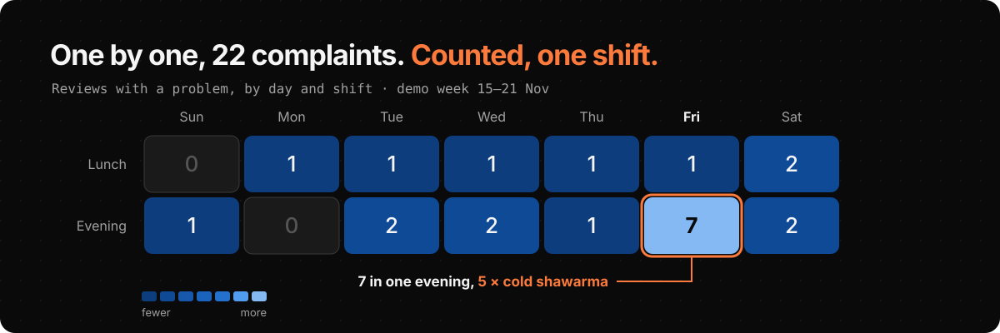
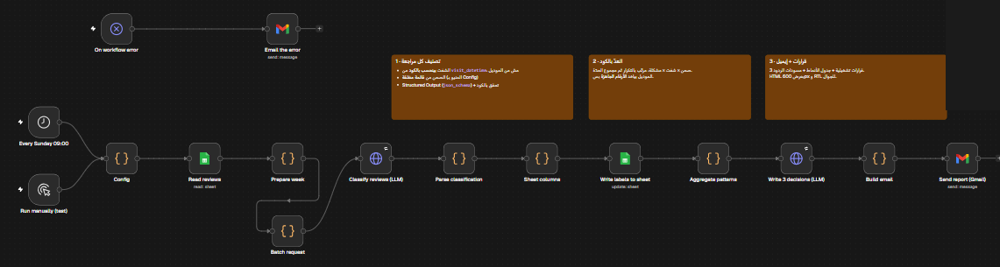
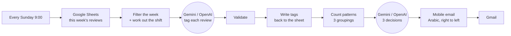
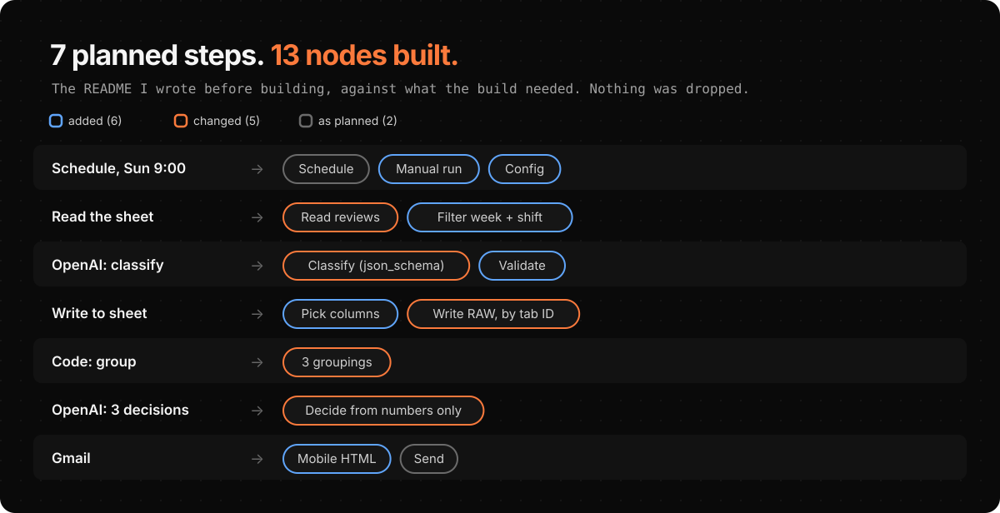

<p align="center"></p>

> **Demo · fictional restaurant, sample data.** Day 1 of my *7 Days · 7 Projects* challenge.

Every Sunday at 9:00, this workflow reads the week's restaurant reviews, tags each one by dish, shift and problem, and counts what repeats. Then the manager and the head chef get one email with three decisions they can act on that week, and a draft reply for every unhappy customer.

The idea is simple: a complaint shouldn't stop at "sorry to hear that". If five people say the shawarma was cold on Friday night, that's a job for the kitchen.

## What happens to each review

These are reviews from the demo data, in Arabic, dialect and English, the way they actually come in.

| Review | What the workflow does |
|---|---|
| «شاورما الدجاج كانت باردة» · Friday 18:40 | **→ Part of a pattern.** One of 5 cold-shawarma complaints on the same Friday evening. It becomes decision #1. |
| «الشاورما وصلت باردة ع الطاولة» · Tuesday 13:20 | **→ Kept separate.** Same dish, same problem, different shift. It doesn't inflate Friday's count. |
| «Shawarma was great tonight, hot and crispy» | **→ Not a complaint.** Mentioning a dish isn't a problem. No draft reply. |
| «لقيت شعرة بالفتوش» | **→ Flagged, even alone.** Severity 5, hygiene. A single complaint like this still reaches the decisions. |
| «التوصيل تأخر كتير، ساعة وعشر دقايق» · Saturday | **→ A weekend pattern.** 3 late deliveries across Friday and Saturday, grouped by weekend rather than by shift. |
| A review from last week | **→ Ignored.** Only the last 7 days are read. |
| The model returns something broken | **→ Marked ⚠️ in the sheet.** The other reviews carry on, and the report still goes out. |

## The Sunday email

<table>
<tr>
<td width="42%" valign="top"></td>
<td valign="top">

**One line at the top.** The strongest pattern of the week and what to do about it.

**The week in four numbers.** Reviews, how many had a problem, how many were positive, average rating.

**Three decisions.** Each one has an owner (chef, floor manager, delivery), a priority, the numbers behind it, and an action someone can check on the next shift.

**The patterns.** Dish × shift, then weekend against weekdays.

**Draft replies.** One per unhappy review, in the customer's language, worst first. They never promise a refund and never blame the customer. Someone still reads them before posting.

<sub>The real email from the first successful run in n8n, with Gemini writing the decisions and replies.</sub>

</td>
</tr>
</table>

## Why counting matters



Read one by one, every complaint looks like bad luck. Counted by day and shift, one square stands out. That's the whole product, and it's why the counting is done by code, not by the model.

## The workflow



The canvas in n8n. The whole week goes to the model in **one** request (Batch request), so a run costs two model calls, not forty-one.



## The problem

Restaurant owners read bad reviews one at a time and answer them one at a time. Nobody notices that six of them are about the same dish on the same shift, so the complaint never reaches the kitchen. Review tools stop at "reply to the customer". The fix usually needs to happen at the grill.

## How it was built

**Stack:** n8n · Google Gemini Flash (free tier) (or any OpenAI-compatible model) · Google Sheets · Gmail

<details open>
<summary><b>Design decisions</b></summary>

- **Runs free.** Any OpenAI-compatible model works. The demo uses Gemini's free tier, paced to stay under its rate limit.
- **The model tags, the code counts.** The decisions model never sees a review. It gets the counts from code and has to cite them. It can't say "7 complaints" when there were 5.
- **Closed lists, not free text.** The dish comes from the menu, and the problem from a fixed list. Otherwise "شاورما", "ساندويش شاورما دجاج" and "شاورما العربي" are three dishes and nothing adds up.
- **The shift comes from the data.** It's worked out from the visit time, not guessed from the text. Reviews almost never say "Friday night".
- **A written severity scale.** From 0 (no problem) to 5 (health and safety). One hair in the food outranks three salty plates.
- **One bad answer doesn't stop the report.** It's marked ⚠️ in the sheet, and the email says how many need a look.
- **Safe by default.** No API key inside any node. Review text is written to the sheet as plain text, so a review starting with `=` never becomes a formula, and it's escaped before it goes into the email.

</details>

<details>
<summary><b>How I tested it, before connecting any account</b></summary>

<br>

The demo data has traps with known answers, and [`data/expected-labels.csv`](data/expected-labels.csv) holds the right label for every review. The test runs the workflow's own Code nodes, read straight from `workflow.json`, with OpenAI mocked.

| Planted in the data | Why |
|---|---|
| 5 cold-shawarma complaints, Friday evening | The pattern that has to come first |
| 3 late deliveries, Friday and Saturday | A weekend pattern, not a shift |
| Cold shawarma, Tuesday lunch | Must not join Friday's count |
| 3 reviews praising the shawarma | Naming a dish isn't a complaint |
| 2 reviews from the week before | The date filter |
| A hair in the fattoush | One complaint, highest severity |

```text
$ node dev/run-local.mjs
✅ date filter: 40 reviews this week, R041/R042 (last week) excluded
✅ shift computed from visit time (R021 → Friday evening, R007 → Tuesday lunch)
✅ top pattern = shawarma · Friday evening · cold_food × 5
✅ decoy cold shawarma on Tuesday lunch is NOT merged into the Friday pattern
✅ delivery delays on the weekend grouped (×3)
✅ positive reviews never counted as issues (incl. positive shawarma R008/R036/R040)
✅ bad model answer (R010) → flagged needs_review, run continues
✅ decisions model receives only aggregates (no review text)
✅ email: RTL, ≤640px, all user text escaped
✅ sheet write-back has exactly the label columns
```

This checks the plumbing. The model itself was measured on the first real run, against the same file:

| On the real run (Gemini) | Result |
|---|---|
| Problem or not | **40 / 40** |
| Right dish | **39 / 40** |
| Right problem type | **39 / 40** |
| The 5 planted cold-shawarma reviews | all 5, all on Friday evening |
| Hair in the fattoush | hygiene, severity 5 |
| Last week's reviews | untouched |

The two misses are honest grey areas: R002 complains about the fries in a review that praises the shawarma, and R014's "pricey for the portion size" came out as portion instead of price.

</details>

<details>
<summary><b>What the plan missed, and the fix</b></summary>

<br>

| What the plan said | What the build needed |
|---|---|
| The model reads the shift from the review | Reviews don't say it. The shift is worked out in code from a new `visit_datetime` column. |
| The dish as free text | A closed menu list, or the same dish splits into three names. |
| One grouping: dish × shift × problem | Three. Late deliveries are a weekend pattern spread over shifts, and one grouping hid them. |
| Nothing on severity | A written 0–5 scale, and single complaints of 4+ always reach the decisions. |
| The OpenAI node, and an OpenAI key | One HTTP request to any OpenAI-compatible API. I didn't have an OpenAI key, so it runs on Gemini's free tier. Switching provider is two lines in Config. |
| One model call per review | **One call for the whole week.** The first real run sent 41 calls and sat for 10 minutes retrying. Batched, a run takes about 1.5 minutes and two calls. |
| Pick a model name and move on | The first name I chose was retired for new keys (404), the newest one was overloaded (503). I listed the models the key can use and picked a stable one. |
| Trust the model's output format | `json_schema` asks for the lists, and code checks every answer anyway, because not every provider enforces the schema strictly. |
| "Read this week's reviews" | A filter with a demo date, and date parsing for both text and Sheets' serial numbers. |
| Nothing on bad answers | Validation that flags the review and lets the run continue. |
| A sheet tab named `reviews` | Google names the tab itself when it converts a CSV (here: "Untitled"), and its ID isn't 0: the first real run failed with *Sheet with ID 0 not found*. The tab name is now a Config value. I also tried finding the tab through the Sheets API, but n8n Cloud doesn't allow Google credentials inside HTTP Request nodes. |

</details>

## Documenting it README-first

Each day of the challenge I try a different way of documenting. For this one I wrote the README **before** building anything, committed it on its own ([first commit](https://github.com/Sfditala/review-to-kitchen-report/commit/11d33a2)), and compared it with what I built.



**The structure held, the details didn't.** No planned step was dropped, but 5 changed and 6 were added. The success criteria I wrote up front turned straight into the test checks, so I knew what "done" meant from the first minute. What the README missed was one question: **where does each field come from?** The shift couldn't come from the review text, and that changed the data itself.

So next time the template gets one more section:

| Field | Comes from | Why |
|---|---|---|
| `review_text`, `rating`, `visit_datetime` | **Input**: the sheet, a delivery app, the till | Raw data. Without the visit time there's no shift |
| `shift`, all counts and totals | **Code** | Fixed rules, and numbers have to be exact |
| `dish`, `issue_type`, `severity` | **Model**, from closed lists | Reading dialect, but with values that can be counted |
| `summary`, `reply_draft`, the 3 decisions | **Model**, free text | Writing, from the code's numbers |

<details>
<summary><b>The original README, written before the build (Arabic, unedited)</b></summary>

<br>

<div dir="rtl">

### review-to-kitchen-report

> **طريقة التوثيق اليوم: README أول.**
> كل اللي فوق الخط الفاصل انكتب **قبل** أول سطر بناء، وانحفظ بـ commit لحاله (`git log -- docs/README.md` بيثبت الترتيب).
> القسم اللي تحت الخط بينكتب **بعد** البناء، ومش مسموح نعدّل اللي فوقه. المقارنة بين النصّين هي التجربة.

---

#### المشكلة (جملة)

صاحب المطعم بيقرأ المراجعات السيئة وحدة وحدة، فما بيلاحظ إنو 6 منها عن **نفس الصحن بنفس الشفت**، وبتضل الشكوى "زعل زبون" بدل ما تصير **أمر شغل للمطبخ**.

#### المستخدم (مين ووقتيش)

| مين | شو بيعمل | وقتيش |
|---|---|---|
| **مدير المطعم** | بيقرأ الملخص والقرارات، بيوزّع المهام، بينسخ مسودات الردود وبينشرها | الأحد الصبح، قبل اجتماع الأسبوع |
| **الشيف الرئيسي** | بيقرأ القرارات اللي بتخص المطبخ | نفس الإيميل |
| **الموظف اللي بيدخّل المراجعات** | بيلصق مراجعات (Google، طلبات، تطبيقات توصيل) بالشيت | طول الأسبوع |

#### المدخلات والمخرجات

**المدخلات**
- Google Sheet اسمه `reviews` فيه سطر لكل مراجعة: رقم المراجعة، التاريخ، المصدر، التقييم (1–5)، نص المراجعة.
- مراجعات بالعربي الفصيح واللهجة والإنجليزي، مخلوطة.

**المخرجات**
1. **جنب كل مراجعة بالشيت:** `dish` · `shift` · `issue_type` · `severity` · `summary` · `reply_draft`
2. **إيميل HTML أسبوعي** للمدير والشيف فيه:
   - ملخص بأرقام (كم مراجعة، كم سلبية، معدّل التقييم)
   - **3 قرارات تشغيلية** مبنية على الأنماط
   - جدول الأنماط (صحن × شفت × مشكلة، مرتّب بالتكرار والحدّة)
   - مسودة رد لكل مراجعة سلبية

#### التدفق (قبل البناء)

```
Schedule (أحد 9:00)
 → Google Sheets: قراءة مراجعات الأسبوع
 → OpenAI (Structured Output): {dish, shift, issue_type, severity, summary, reply_draft}
 → Sheets: كتابة التصنيف جنب كل مراجعة
 → Code: تجميع (dish × shift × issue) + ترتيب حسب التكرار والحدّة
 → OpenAI: كتابة 3 قرارات تشغيلية من الأنماط
 → Gmail: إيميل HTML (ملخص + قرارات + جدول + مسودات الردود)
```

**توقّعات قبل البناء:**
- 6 nodes تقريباً، ما في تفرّعات.
- الموديل بيستخرج الصحن والشفت من نص المراجعة.
- مكالمة OpenAI وحدة لكل مراجعة (40 مكالمة)، بموديل mini.
- الوقت المتوقع: 3–4 ساعات.

#### معايير النجاح

- [ ] النمط المزروع (5 شكاوى برودة شاورما بشفت الجمعة المسائي) **بيطلع بأول قرار**
- [ ] النمط التاني (3 تأخير توصيل بالويكند) بيظهر بالجدول
- [ ] المراجعات الإيجابية **ما بتطلع كمشاكل**
- [ ] الإيميل مقروء على الجوال (عرض ≤ 600px، اتجاه RTL)
- [ ] ولا مفتاح API مكتوب جوا node

---

#### بعد البناء: شو تغيّر عن الخطة؟ وليش؟

*(بينكتب بعد البناء. ممنوع تعديل أي إشي فوق الخط.)*

</div>

</details>

## What it doesn't do

- **It needs the visit time** to know the shift. Google reviews alone don't have it. Delivery apps and point-of-sale systems do.
- **It doesn't post replies.** The drafts stay with the manager, on purpose.
- **A quiet week sends nothing.** If there are no reviews in the last 7 days, the run stops without an email.
- **The menu is set once** in the Config node. A new dish that isn't on the list comes out as "غير محدد" (unidentified).

## Run it yourself

1. In n8n, go to **Workflows → Import from File** and choose [`shared/error-alert.workflow.json`](shared/error-alert.workflow.json), then [`workflow.json`](workflow.json).
2. Import [`data/reviews.csv`](data/reviews.csv) into a new Google Sheet.
3. In the **Config** node, set `sheet_id`, `sheet_tab` (the tab's name) and `report_to`.
4. Connect Google Sheets and Gmail, plus a **Header Auth** credential for the model: name `Authorization`, value `Bearer <your key>` (a free Gemini key from Google AI Studio works). Set `D0 · error-alert` as the error workflow in Settings.
5. Run **Execute workflow**. The email arrives in about 2 minutes. For production, clear `reference_date` and publish.

Full setup in Arabic, including Google OAuth and costs: [`docs/SETUP.md`](docs/SETUP.md). What to check after the first run: [`docs/review-checklist.md`](docs/review-checklist.md).

This export contains no credentials or webhook IDs. Personal IDs are replaced with placeholders, and [a check](scripts/check-clean.mjs) runs on every push, together with the offline tests.

## العربية

<div dir="rtl">

كل أحد الساعة 9، النظام بيقرأ مراجعات المطعم من الأسبوع، بيصنّف كل وحدة حسب الصحن والشفت ونوع المشكلة، وبيعدّ شو اللي بيتكرر. بعدين بيوصل للمدير والشيف إيميل فيه 3 قرارات تشغيلية، ومسودة رد لكل زبون زعلان.

الفكرة إنو الشكوى ما توقف عند "نعتذر عن الإزعاج". إذا 5 زباين حكوا إنو الشاورما كانت باردة ليلة الجمعة، هاد شغل للمطبخ.

المشروع تجريبي على مطعم خيالي وببيانات تجريبية، وهو اليوم الأول من تحدي "7 أيام · 7 مشاريع".

</div>

---

<p align="center">Built by <a href="https://portfolio-mauve-seven-44.vercel.app/"><b>Tala Safadi</b></a>, AI Engineer · <a href="https://www.linkedin.com/in/talasfdi">LinkedIn</a><br>More systems: <a href="https://github.com/Sfditala/uni-email-to-tasks">Uni Email to Tasks</a> · <a href="https://github.com/Sfditala/clinic-ai-receptionist">Clinic AI Receptionist</a> · <a href="https://github.com/Sfditala/ai-marketing-team">AI Marketing Team</a></p>
